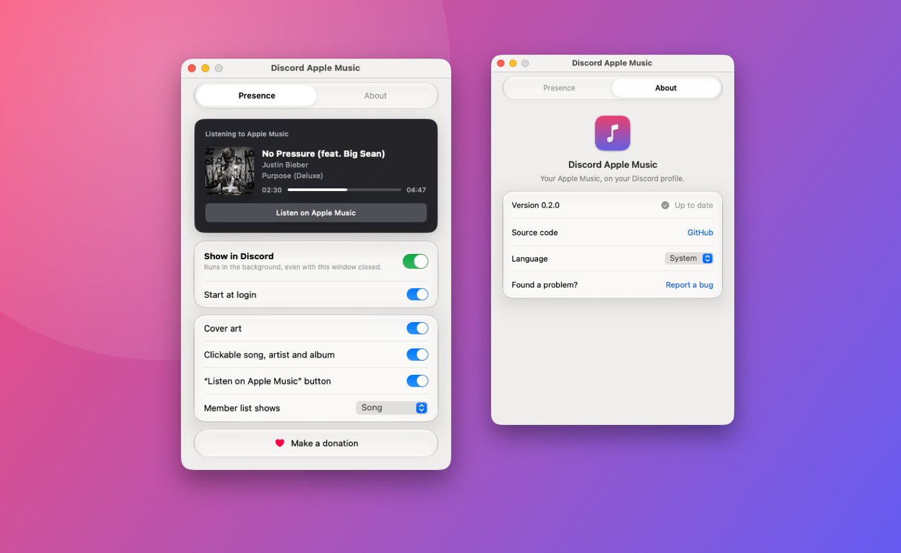

# Discord Apple Music

[](https://buymeacoffee.com/jualopezmo)

Show what you're playing in **Apple Music** on your Discord profile as **"Listening to Apple Music"**, the same way Spotify does: song, artist, album cover, a live progress bar, and links that open the track in Apple Music.



A small native macOS app (about 5 MB). No Discord mods required: it talks to the regular Discord desktop app over its local Rich Presence socket.

## Features

- **"Listening to Apple Music"** on your profile, with cover art, a live progress bar and a "Listen on Apple Music" button
- **Live preview** of your Discord card in the app, updated as you change the options
- **Clickable** song, artist and album, like Spotify
- **Runs in the background** with no menu bar or Dock icon, and optionally starts at login
- **Updates itself** from GitHub Releases, after checking the download's signature
- **English and Spanish**

## Requirements

- macOS 14 or later (Apple Silicon or Intel), with the Music app
- Discord desktop app, running

## Install

```bash
brew install --cask juan-motta/tap/discord-apple-music
```

Or download `DiscordAppleMusic-<version>-macos.zip` from [Releases](https://github.com/Juan-Motta/discord-apple-music/releases), unzip it and move **Discord Apple Music** to Applications.

The app is signed and notarized by Apple.

## Use

Open **Discord Apple Music** and turn on **Show in Discord**. It keeps working in the background after you close the window, with no menu bar or Dock icon, and starts at every login unless you turn off **Start at login** (then it starts when you open the app).

Open the app again to turn it off or change what's shown. The card at the top previews your Discord profile and changes as you toggle:

- cover art
- clickable song, artist and album
- the "Listen on Apple Music" button
- what the member list shows next to your name: song, artist or "Apple Music"

The app is in English and Spanish; it follows your Mac's language, or pick one under **About → Language**. The **About** tab also has a link to report a bug, and shows the app's version. When a newer release is out, an **Update** button downloads it, checks that it's signed by the same developer, and restarts the app on the new version.

## Permissions

The first time it reads Apple Music, macOS asks whether **Discord Apple Music** may control **Music**. Click **Allow**.

If you clicked Don't Allow, nothing shows in Discord and the app says "Allow access to Music". Click **Open Settings** and turn on Music under Discord Apple Music in **Privacy & Security → Automation**.

## How it behaves

- **Paused or stopped:** the status disappears, like Spotify.
- **Discord closed:** keeps waiting and reconnects when Discord opens.
- **Updates:** reacts to Music's own play, pause and track-change notifications, and checks every 15 seconds for seeks. It only talks to Discord when something changed.
- **Cover art and links:** looked up through the public iTunes Search API. Songs that aren't in the Apple Music catalog (your own uploads) show without a cover.
- **The "Listen on Apple Music" button:** other people see it on your profile, but Discord never shows your own buttons to you. The song title, artist, and cover are also clickable links, and those you can see.

## Uninstall

```bash
brew uninstall --cask discord-apple-music
```

If you installed it by hand, turn off **Show in Discord** first, then move the app to the Trash.

## Development

A Swift package, built with the Xcode Command Line Tools (no Xcode project needed):

```
Sources/PresenceCore/             pure logic: what to show and when to update (no macOS APIs)
Sources/PresenceKit/              Apple Music (AppleScript), Discord IPC, iTunes artwork, settings
Sources/DiscordAppleMusicAgent/   background agent, packaged as a helper app inside the app
Sources/DiscordAppleMusic/        the SwiftUI window
Bundle/                           Info.plists, launchd plist, entitlements, icon, translations
```

```bash
swift test
```

```bash
scripts/build-app.sh --no-notarize   # universal, signed app -> dist/
```

### Releasing

```bash
scripts/release.sh               # test, build, sign and notarize -> dist/*.zip
scripts/release.sh --publish     # same, then tag, create the GitHub Release and update the Homebrew cask
```

To ship a new version, bump `VERSION`, commit and push to `main`, then run `scripts/release.sh --publish`. It refuses to start unless the working tree is clean, `main` matches `origin/main`, and that version has no tag or release yet.

The tap step edits `Casks/discord-apple-music.rb` in [Juan-Motta/homebrew-tap](https://github.com/Juan-Motta/homebrew-tap) through the GitHub API. To preview it without changing anything:

```bash
scripts/update-tap.sh <version> <asset url> <sha256> --dry-run
```

Notarization needs a notarytool keychain profile, created once:

```bash
xcrun notarytool store-credentials discord-apple-music --apple-id <apple id> --team-id <team id>
```

## Support

If you enjoy it, you can [buy me a coffee](https://buymeacoffee.com/jualopezmo). There's also a **Make a donation** button in the app.

## License

MIT
